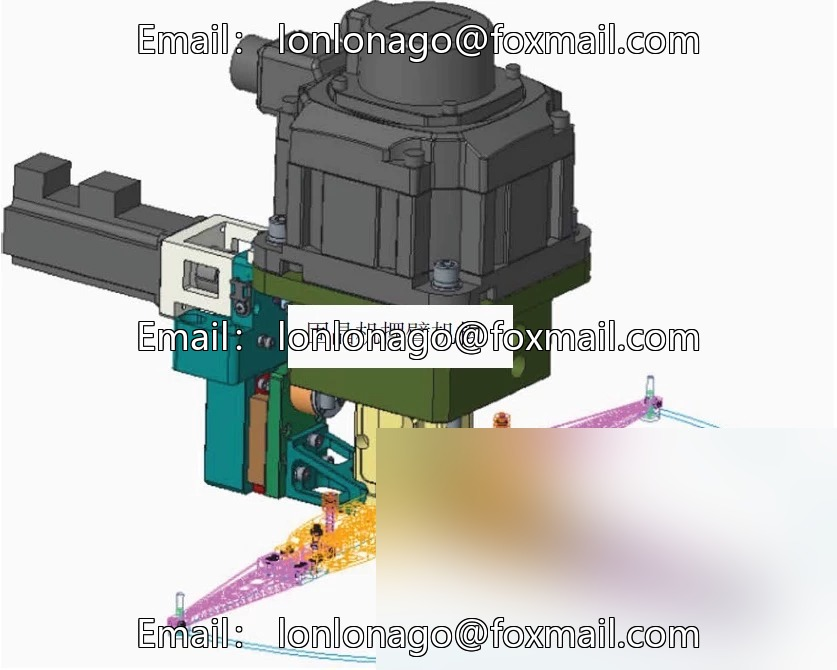
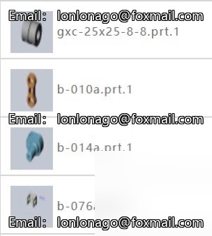
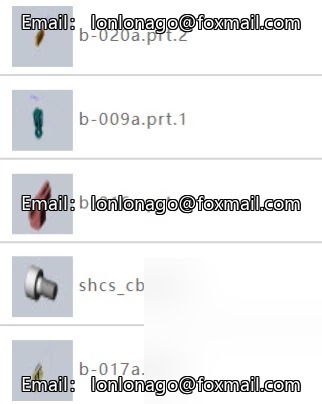

# Gluster machine arm mechanism

## Body

Grystal machine rearming mechanism

There is referential details, which has very great referential value

CREO3. 0 Parts and assemblies (asm and prt files)
Editable

If there is a need, directly grab it and leave the email.

Sales do not refund; do not respond to detailed inquiries; thank you.

Not providing technical support

Reference details for the solid-crystal machine arm mechanism are provided; creo3.0 part and assembly files can be edited, along with multiple file names and model identifiers.

<!-- AI_ENRICHED -->

## Images

## Payment

Here is a pay link on Stripe ( https://buy.stripe.com/3cs8yP7sY87d0vu9AB ). Please contact me lonlonago@foxmail.com after funding $89, and I will send you a complete data files , thank you!

